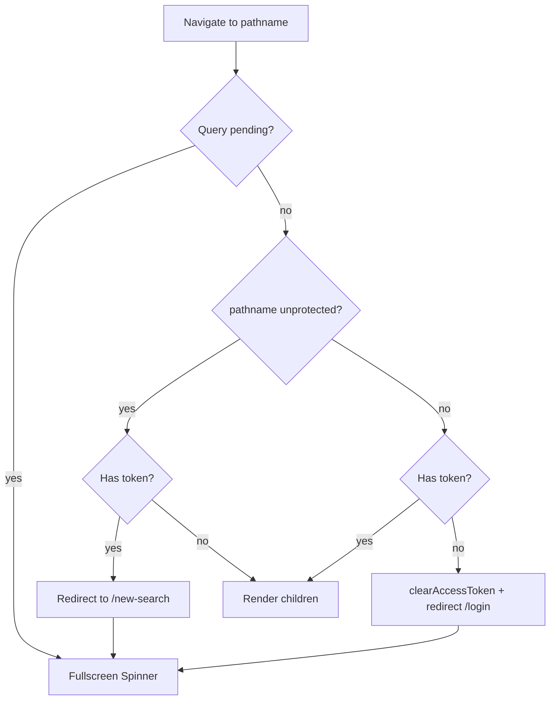

# AuthShell

AuthShell is the **root-level client gate** that decides whether the user may see the current route based on the presence of an access token in the browser. It wraps the entire app tree from the root layout so every page goes through the same auth check before rendering.

---

## Table of contents

1. [Purpose and scope](#purpose-and-scope)
2. [Where it lives and how it mounts](#where-it-lives-and-how-it-mounts)
3. [Dependencies](#dependencies)
4. [Public vs protected routes](#public-vs-protected-routes)
5. [Token detection (`useAccessToken`)](#token-detection-useaccesstoken)
6. [Decision logic](#decision-logic)
7. [Redirects and side effects](#redirects-and-side-effects)
8. [`redirectingRef`: why it exists](#redirectingref-why-it-exists)
9. [Loading UI](#loading-ui)
10. [Relationship to `AppShell`](#relationship-to-appshell)
11. [Extending the system](#extending-the-system)
12. [Flows (diagrams)](#flows-diagrams)
13. [Troubleshooting](#troubleshooting)

---

## Purpose and scope

| Concern | AuthShell | Not AuthShell |
|--------|-----------|----------------|
| Is there a stored access token? | Yes | — |
| Redirect unauthenticated users away from app pages | Yes | — |
| Redirect logged-in users away from `/login` and `/register` | Yes | — |
| Validate token with the API (session still valid, user exists) | No | `AppShell` uses `/auth/me` |
| Per-route role checks | No | Add middleware or page-level logic |

AuthShell answers: **“Does this client have a token string in storage?”** — not **“Is this token accepted by the backend?”** Backend validation happens later (for example in `AppShell`).

---

## Where it lives and how it mounts

| Item | Value |
|------|--------|
| Component | `frontend/components/app/AuthShell.tsx` |
| Mount point | `frontend/app/layout.tsx` — wraps `{children}` **inside** `Providers` |

Order in `RootLayout`:

1. `<Providers>` — provides `QueryClientProvider` (required because `AuthShell` uses TanStack Query via `useAccessToken`).
2. `<AuthShell>` — runs auth routing logic.
3. Page content as `children`.

If `AuthShell` were placed **outside** `Providers`, `useAccessToken` would not have a query client and would throw.

---

## Dependencies

### React / Next.js

- **`useRouter`**, **`usePathname`** from `next/navigation` — SPA navigation without full reload.
- **`useEffect`**, **`useRef`** — coordinate redirects once per logical navigation.
- **`children`** — the rest of the app (layouts and pages).

### Auth and data

- **`useAccessToken`** (`@/components/auth/queries`) — TanStack Query hook that reads the token synchronously from `localStorage` (see below).
- **`clearAccessToken`** (`@/lib/auth`) — removes `access_token` from `localStorage` when sending the user to login.

### UI

- **`Spinner`** (`@/components/ui/spinner`) — centered loading indicator during token resolution or pending redirects.

---

## Public vs protected routes

Protected routes are **the default**: any path that does **not** match an “unprotected” prefix requires a token.

Unprotected routes are declared in-code:

```ts
const UNPROTECTED_ROUTES = ["/login", "/register"];
```

Matching uses **prefix** checks:

```ts
const isUnprotected = UNPROTECTED_ROUTES.some((route) =>
  pathname.startsWith(route),
);
```

Implications:

- `/login`, `/login/anything` → treated as **unprotected** (because `startsWith("/login")`).
- `/register` → **unprotected**.
- Everything else (`/`, `/new-search`, `/sessions/123`, `/api-docs` under the same app router, etc.) → **protected** unless you add exceptions.

When adding routes, confirm you do **not** accidentally expose app pages because a new path unexpectedly `startsWith` `/login` or `/register`.

---

## Token detection (`useAccessToken`)

Source: `frontend/components/auth/queries.ts`.

Behavior:

1. **Query key:** `["accessToken"]`.
2. **Query function:** Calls `getAccessToken()` from `frontend/lib/auth.ts`, which reads `localStorage.getItem("access_token")` (only in the browser; SSR returns `null`).
3. If there is **no** token string, the query **rejects** with `new Error("No access token")` — TanStack Query marks the query **`isError`**, **`data`** is unset.
4. **Retry:** disabled (`retry: false`).
5. **`staleTime: Infinity`** and no refetch on mount/focus/reconnect — the token snapshot is intentional: it does not repeatedly poll storage; logout/login flows should invalidate or update cache where needed (typically by navigating or other components setting storage and invalidating queries if you add that pattern).

Interpretation inside `AuthShell`:

- **`isPending`** — initial read not finished (brief on client).
- **`hasToken`** — query settled successfully and `data` is a non-empty string.
- **`noToken`** — query settled AND (`isError` OR no `data`) — treats missing token and “reject from queryFn” the same way.

---

## Decision logic

Variable summary (conceptual):

| Name | Meaning |
|------|---------|
| `isUnprotected` | Current `pathname` starts with `/login` or `/register`. |
| `hasToken` | Access token query succeeded with a value. |
| `noToken` | Access token query finished and there is no usable token. |
| `shouldRedirectToLogin` | User has **no** token but is on a **protected** route. |
| `shouldRedirectToApp` | User **has** a token but is on an **unprotected** route. |

There is **no** branch for “token present but invalid”; that is **not** AuthShell’s job.

---

## Redirects and side effects

### To login

When `shouldRedirectToLogin` is true:

1. `clearAccessToken()` is called (idempotent if already empty — ensures stray keys are cleared before login).
2. `router.replace("/login")` — replaces history entry so Back does not return to a protected route without auth.

### To app home

When `shouldRedirectToApp` is true:

1. `router.replace("/new-search")` — logged-in users hitting login/register land on the main workspace entry used by this project.

Effects run inside `useEffect` with dependencies **`[shouldRedirectToLogin, shouldRedirectToApp]`** (not `[pathname]` alone). Booleans derive from pathname + query state, so when either flips after navigation or token change, the effect re-evaluates.

---

## `redirectingRef`: why it exists

`redirectingRef` is reset to `false` whenever **`pathname`** changes (first effect).

The redirect effect checks `redirectingRef.current` at the start; if already `true`, it **returns** without issuing another navigation.

Purpose: avoid **double redirects** or effect churn in Strict Mode / rapid re-renders. After triggering `router.replace`, the flag is set `true` so duplicate effect runs before `pathname` updates do not fire again.

Known tradeoff: the dependency array intentionally omits `router`; Next’s `router` reference is assumed stable enough for typical App Router setups.

---

## Loading UI

AuthShell renders a **blocking full-screen spinner** when **any** of these hold:

1. `accessTokenQuery.isPending` — token resolution not complete.
2. `shouldRedirectToLogin` — about to send user to `/login`.
3. `shouldRedirectToApp` — about to send user to `/new-search`.

While those are true, **`children` are not rendered** — flashes of protected content are prevented.

After the gate clears, AuthShell renders **`<> {children} </>`** with no wrapper DOM (fragment only).

---

## Relationship to `AppShell`

| Layer | Role |
|-------|------|
| **AuthShell** | Wraps entire app from root layout. Token presence + route class (public vs app). |
| **AppShell** | Used inside authenticated **app** routes. Loads `userInfo` via `/auth/me`, sidebar, session list, logout, etc. |

Typical user journey:

1. Land on app without token → AuthShell → login.
2. Log in → token stored → AuthShell allows children → pages that use `AppShell` call API with token.
3. If `/auth/me` fails, `AppShell` clears token and sends to login — **second line of defense** after AuthShell.

---

## Extending the system

### Add a public marketing page (example `/about`)

1. Add `"/about"` to `UNPROTECTED_ROUTES` in `AuthShell.tsx` **or** use a dedicated prefix like `"/(public)"` if you group routes in the filesystem and still match `pathname` accordingly (Next.js `pathname` is the URL path, not the folder name with route groups — use the actual URL).

2. Decide redirect behavior: today, **any** unprotected route with a token sends the user to `/new-search`. If you need token users to see `/about`, you must adjust `shouldRedirectToApp` logic (e.g. only redirect from `/login` and `/register`, not from every unprotected path).

### Change post-login landing

Update the `router.replace("/new-search")` target in `AuthShell.tsx` when `shouldRedirectToApp` fires, or redirect from login success only and narrow `shouldRedirectToApp`.

### Invalidate token cache after login

`useAccessToken` uses TanStack Query. After setting the token with `setAccessToken`, ensuring the next route sees the token may require **`queryClient.invalidateQueries({ queryKey: ["accessToken"] })`** in the login success handler unless you navigate in a way that remounts and refetches according to your app’s patterns. AuthShell itself does **not** invalidate on storage events.

---

## Flows

### High-level routing



### Sequence: first visit protected route without token

1. Hydration / client run → `useAccessToken` runs → rejects or null → `noToken` true.
2. `isUnprotected` false → `shouldRedirectToLogin` true.
3. Spinner → effect runs → `clearAccessToken` + `replace("/login")`.
4. Pathname becomes `/login` → `isUnprotected` true → `shouldRedirectToLogin` false.
5. Still `noToken` → user stays on login page; children render (login UI).

---

## Troubleshooting

| Symptom | Things to verify |
|---------|-------------------|
| Infinite spinner | `pathname` stuck; redirect effect not running; check `redirectingRef` / effect deps; confirm `Providers` wraps `AuthShell`. |
| Flash of dashboard then login | Unlikely here because children gated; if seen, duplicate auth layer may render before token cleared. |
| Logged-in user cannot open `/login` | By design — `shouldRedirectToApp` sends them to `/new-search`. |
| Public page redirects when logged in | All `UNPROTECTED_ROUTES` currently behave the same — adjust conditional redirect. |
| Token in storage but “not logged in” | Confirm key is **`access_token`** (`ACCESS_TOKEN_KEY` in `lib/auth.ts`) and QueryClient wraps the tree. |
| SSR hydration mismatch | AuthShell gates on client-side storage; initial server HTML may still be minimal before client runs — expected for auth-in-localStorage patterns. |

---

## Props API

```ts
type Props = {
  children: ReactNode;
};
```

- **`children`** — entire Next.js App Router subtree for the current navigation.

---

## File reference checklist

| File | Relevance |
|------|-----------|
| `components/app/AuthShell.tsx` | This component |
| `app/layout.tsx` | Wraps children with AuthShell inside Providers |
| `components/providers.tsx` | Query client for `useAccessToken` |
| `components/auth/queries.ts` | `useAccessToken` implementation |
| `lib/auth.ts` | `getAccessToken`, `setAccessToken`, `clearAccessToken` |
| `components/app/AppShell.tsx` | Backend session validation (`/auth/me`) for logged-in UX |
